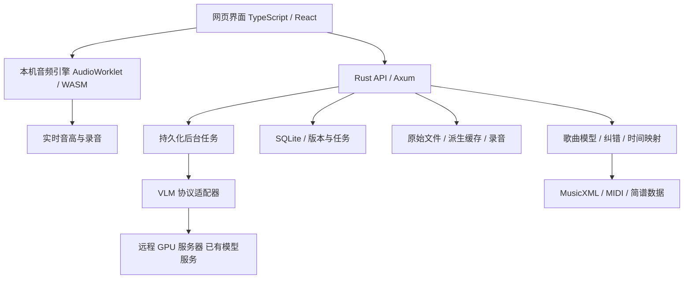

# 系统架构

实现更新2026-10-27：实际源码为src/{server,store,score,recognition,metadata}.rs、web/React组件及web/audio；尚未拆成下方规划的多crate结构。SQLite保存JSON、谱面历史、任务与配置，原件保存在data/assets。Tauri、移动端和科学计算worker仍为未来选项。

## 建议的组成

采用模块化单体：一个网页前端、一个 Rust 服务、一个持久化任务队列；VLM 是外部已部署依赖。先不引入 Redis、Kubernetes 或多个微服务。



React、Axum、具体包版本均为候选，开始实现时再核实兼容与许可证并固定版本。实时麦克风分析与播放在客户端完成，不因 SSH 网络延迟卡住音高线。后台负责文件、识别、校验、版本、导出和可选离线音频处理。

## 为什么使用 Rust 与 TypeScript

- TypeScript/React/Vite SPA：处理网页交互、音符点击、图表与浏览器音频接口；独立于服务端渲染框架，便于打包。
- Rust：服务端文件与任务管理、确定性的歌曲与时间计算；适合逐步形成 WASM 与原生共享核心。
- DSP crate 与 score-core 不依赖 Axum、磁盘或操作系统，分别编译原生/WASM。浏览器与服务端通过显式版本协议交互。
- 不以“Rust 内存安全”代替输入校验、权限和音频算法测试。Rust 也不会自动解决识谱质量或跨平台设备差异。
- Python 暂不作为必需运行时；未来若离线对齐、人声分离确实需要科学计算生态，可接独立 worker，不污染核心协议。

## 模块边界

| 模块 | 职责 |
|---|---|
| Library / Import | 歌曲工程、原图和音频、哈希、分页和缩略图 |
| Recognition | VLM 适配、裁片、多图上下文、结果校验、任务重试 |
| Score Core | 节拍、音符、歌词关联、乐句、重复展开、编辑命令 |
| Alignment | 谱面到演奏顺序及音频时间映射、锚点、缺失段 |
| Transport | 播放、暂停、跳转、变速、循环、间隔、音源切换 |
| Audio Engine | 谱面驱动的钢琴音源、钢琴移调与速度、原音频原速原调播放、输入输出和延迟补偿 |
| Pitch Monitor | 基频、可信度、门限、平滑、曲线 |
| Recorder | 人声录音、练习事件轨迹、录音恢复与回放 |
| Settings | API、设备、音名惯例、音高基准、性能与数据位置 |

## 数据与接口

SQLite 保存元数据、版本快照、校准锚点、任务状态、配置引用；大音频与图片放文件系统。歌曲规范 JSON 为权威数据，MusicXML/MIDI/渲染布局为派生产物。缓存键包含素材哈希、歌曲版本、算法/模型/提示词版本及必要播放参数。

API 草案：/api/v1/projects、assets、recognition-jobs、score-revisions、alignment-revisions、recordings、exports、providers。写入带 baseRevision 防止旧页面覆盖新编辑。后台进度先用 SSE；上传、取消、重试幂等，错误区分格式、模型不可达、超时、冲突和资源不足。UI 刷新能恢复任务状态；进程恢复时对中断任务显式重试，避免重复提交覆盖版本。

API 密钥仅保存在服务端秘密存储；Windows 可用系统凭据机制，Ubuntu 可用权限受限文件或服务秘密。普通配置只保存 secretRef。地址与端口使用管理员配置的允许范围，禁用从模型输出获取任意 URL；私网 远程 GPU 服务器 是明确配置目标，不能被通用私网阻断规则误伤。浏览器不持有 SSH 私钥。

## 远程 GPU 服务器 接入

优先复用已有 HTTP 推理 API；如果只允许 SSH，则由受控、本机回环端口的 SSH 转发接入。SSH 仅是连接通道，不在每次识谱时执行远端 shell。校验已有主机身份，不自动接受未知/变化的主机密钥。

适配器先支持实际服务能接受的多模态协议，OpenAI-compatible 只是候选而非对现状的假设。设置页管理 provider、base URL、model、secretRef、多图上限、图像尺寸、超时、请求预算、结构化结果能力。连通测试展示目标与结果；上传到不同目标时清楚显示数据目的地。无自动公网回退。

## 部署与迁移

首版运行目录 E:/Softwares/Services/music-practice。实现后拟默认绑定 127.0.0.1，服务同源提供静态网页和 API，端口经检查后配置，不假定可用。首次为前台可停止运行；开机启动属于后续单独操作。

可迁移性原则：相同服务与相对数据布局，数据根目录由配置提供；隔离文件路径、秘密存储、设备访问与进程管理。备份需要 SQLite 一致性备份与素材清单，不复制正在写入的数据库就声称备份成功。Ubuntu 的安装和服务管理具体方案暂不设计。

桌面与手机：保留静态网页前端、独立 Rust 核心和 HostAdapter 接口；Tauri 2 仅作未来候选，尚未选定最终包装方案。按用户要求，暂不开展跨平台打包、移动端后台音频、离线资源下载或录音同步设计。

当前仅针对本机服务规划，默认不修改防火墙或暴露服务。未来增加网络访问时再核查 HTTPS、鉴权和麦克风权限要求。

## 未来目录（仅设计，尚未创建实现文件）

```text
music-practice/
  README.md / AGENTS.md / docs/
  apps/web/                 React SPA
  apps/desktop/             后续 Tauri
  crates/score-core/         规范歌曲模型和编辑
  crates/timeline-core/      时间映射和循环语义
  crates/audio-dsp/          可共享音频计算
  crates/server/             API、任务和持久化
  packages/contracts/        生成的 TS 类型和 Schema
  packages/notation/         简谱与五线谱映射
  packages/audio-web/        AudioWorklet 与设备适配
  tests/fixtures/            人工标注与合成素材
  tests/e2e/                 浏览器工作流
  config/                    无密钥配置样例
  data/                      用户数据，排除版本控制
  scripts/                   有边界的运行、备份工具
```
